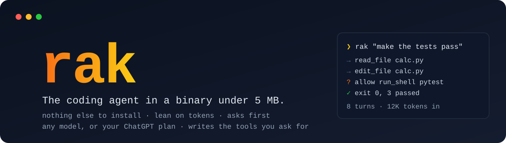

<p align="center">
  
</p>

<p align="center">
  <a href="https://github.com/ayman3000/rak/actions/workflows/ci.yml"></a>
  <a href="https://github.com/ayman3000/rak/releases"></a>
  
  
  <a href="LICENSE"></a>
</p>

<p align="center">
  <a href="#whats-new">What's new</a> ·
  <a href="#install">Install</a> ·
  <a href="#quick-start">Quick start</a> ·
  <a href="#features">Features</a> ·
  <a href="#providers">Providers</a> ·
  <a href="#benchmarks">Benchmarks</a> ·
  <a href="#documentation">Docs</a>
</p>

# rak — Rust Agent Kit

**rak is a coding agent for the terminal.** You give it a task; it reads your project, edits files, runs commands, and tells you what it did. It is one binary of a few megabytes with nothing else to install, it works with sixteen providers or any OpenAI-compatible server, and it asks before it changes anything.

rak is the cross-platform sibling of [sak](https://github.com/ayman3000/sak). sak is built on SwiftAgentKit and stays the Mac tool; rak carries the same prompt, the same tool designs and the same loop to Linux and macOS.

```bash
curl -fsSL https://raw.githubusercontent.com/ayman3000/rak/main/install.sh | sh
```

> [!NOTE]
> **Early alpha.** The core works and is tested on every push. See [Status](#status) for what isn't there yet.

## What's new

**v0.1.0-alpha.41** (2026-11-19)

- **Tools of your own.** Say "I need a tool that …" or type `/make-tool`. rak writes one small script (Python's standard library by default), shows it to you whole, and asks before saving. The tool is tried once, joins the chat with your next message, and is there in every later chat. No rebuild, nothing to install, and `rak update` leaves your tools alone. ([how it works](docs/tools.md#tools-of-your-own))
- **Keys stay out of scripts.** A tool names the key it needs and you give it once with `/key BRAVE_API_KEY`, typed hidden. A tool gets only the keys it names, and a key it prints is hidden from the model.
- **`/tools remove NAME`** deletes one of your tools; `/tools` lists them after rak's own.

<details>
<summary><b>Earlier releases</b></summary>

- **alpha.40:** add an MCP server from its page: `rak mcp add https://github.com/…` reads the JSON, shows what will run and asks; `rak mcp add` alone takes pasted JSON or three questions; `/mcp add` does it inside a chat.
- **alpha.39:** a chat shows its prompt at once and connects MCP servers behind it: on a Mac with one MCP server, the time until typed text appears went from 811 ms to about 8 ms.
- **alpha.38:** a `--tools` list holds for helper agents too; the agent no longer sends you to `/add-dir` for folders it can never open, and uses `past_chats` for earlier chats; fixes to Sign in with ChatGPT and to adding skills from very large repositories.
- **alpha.37:** every skill is a chat command: `/sdd-plan add a login page` asks the agent to load that skill and follow it for your request.
- **alpha.36:** `rak skills add … -y` sums each skill up in a few lines, and a repository of skills costs GitHub two requests, not one more per skill.
- **alpha.35:** add every skill in a GitHub repository (`rak skills add https://github.com/OWNER/REPO`), remove one from a chat (`/skills remove NAME`), and skill descriptions written over several lines are read whole.
- **alpha.34:** a ChatGPT plan uses the prompt cache: on two real tasks the cached share went from 24% to 90% and from 1% to 84%.
- **alpha.33:** Sign in with ChatGPT: `rak login chatgpt` and the `chatgpt` provider run requests on your ChatGPT plan, with no API key ([how it works](docs/providers.md#your-chatgpt-plan)). Also `/add-dir PATH` and `--add-dir PATH`, to let the agent work in one more folder.
- **alpha.32:** saving a chat no longer opens every other saved chat (about ten times faster with large chats).
- **alpha.31:** the `Thinking…` line, the `past_chats` tool, and answers that wrap at words.
- **alpha.30:** a folder remembers its provider, model and effort.
- **alpha.29:** add keys without opening the key file: `rak keys set NAME`, `/key`, and `/provider` asks for a missing key.
- **alpha.28:** reasoning effort as a setting (`/effort`, `--effort`, `RAK_EFFORT`); chats start at medium.
- **alpha.26 and alpha.27:** `rak update`, which only goes forward unless you name a release.

Every release is on the [releases page](https://github.com/ayman3000/rak/releases).

</details>

## See it work

```
$ rak -m kimi-k2.6:cloud "Make the tests pass."
→ list_dir path=.
  ✓ calc.py test_calc.py
→ read_file path=calc.py
→ read_file path=test_calc.py
→ run_shell python3 -m unittest test_calc -v
? allow run_shell python3 -m unittest test_calc -v
  [y]es  [n]o  [a]lways for run_shell  [A] everything this session › y
  ✓ exit 1 test_average ... ok test_average_of_nothing_is_zero ... ERROR …
→ edit_file calc.py  (7 → 9 lines)
  ✓ Replaced 1 occurrence in calc.py.
→ run_shell python3 -m unittest test_calc -v
  ✓ exit 0 …
All 3 tests pass. I fixed two bugs in `calc.py`: …
  8 turns · 8 tool calls · 12127 tokens in · 653 out
```

## Why rak

<table>
<tr><td><b>Small and light</b></td><td>One binary of <b>under 5 MB</b>. A chat is ready for typing in about 8 ms on a Mac (measured on alpha.39). A short request uses about <b>18 MB</b> of memory on a Mac (measured on alpha.33); Hermes Agent used 357 MB in the <a href="docs/benchmarks.md#head-to-head-with-hermes">head-to-head</a>.</td></tr>
<tr><td><b>Cheap per call</b></td><td>A short prompt and a lean tool set, so every model call sends less. On the same six tasks rak sent <b>314K</b> input tokens where Hermes Agent sent 1,660K.</td></tr>
<tr><td><b>Any model</b></td><td>Sixteen providers by name, your ChatGPT plan by signing in, any OpenAI-compatible server by address, Claude through Anthropic's own API with prompt caching, and automatic fallback to another provider when one fails.</td></tr>
<tr><td><b>Asks first</b></td><td>Every edit and command waits for your yes and shows exactly what will run. A no stops the request.</td></tr>
<tr><td><b>Remembers the project</b></td><td>Notes, roadmap and journal in a plain <code>rak/</code> folder you can read and commit, loaded at the start of every session.</td></tr>
<tr><td><b>Built for big codebases</b></td><td>A code map, line-range reads, a task list, parallel helper agents and context compaction keep it working when the project is too big to read whole.</td></tr>
</table>

## Install

**Linux or macOS**, the newest release, checked against its SHA-256 checksum and put in `~/.local/bin`:

```bash
curl -fsSL https://raw.githubusercontent.com/ayman3000/rak/main/install.sh | sh
```

**From source**, with Rust 1.88 or newer ([rustup.rs](https://rustup.rs)). This builds `main`, which may be ahead of the newest release:

```bash
cargo install --git https://github.com/ayman3000/rak --locked
```

<details>
<summary><b>More install options</b></summary>

- **Pick a release or a folder:** `RAK_VERSION=v0.1.0-alpha.24` picks a release (default: the newest, pre-releases included); `RAK_INSTALL_DIR` picks the folder. Nothing else on your system is changed.
- **Builds:** Linux on x86-64 and ARM (static, any distribution), macOS on Apple Silicon and Intel. Windows is not supported yet.
- **Read before you run:** download the script first (`curl -fsSL https://raw.githubusercontent.com/ayman3000/rak/main/install.sh -o install.sh`), read it, then run `sh install.sh`.
- **macOS:** the builds are not notarized. Installed with the script they just run; a build downloaded in a web browser needs `xattr -d com.apple.quarantine rak` first.
- **Updating:** `rak update` installs the newest release in place of the one you run, checked the same way (from alpha.26; before that, run the install command again). `rak update alpha.24` picks a release; `rak update --check` only says whether a newer one is out. If you used both the script and `cargo install` at some point, remove the other copy (`cargo uninstall rak`) so the right one runs.
- **Pre-built archives** are on the [releases page](https://github.com/ayman3000/rak/releases).

</details>

## Quick start

```bash
rak                                    # a chat; the first run sets itself up
rak "explain what this project does"   # one request, then exit
rak -c "and now add the tests"         # continue this folder's last chat
```

1. **Run `rak`.** The first time, it asks for a provider (Ollama on your machine comes first when it is running, and needs no key), the provider's key (hidden as you type, saved readable by you only, checked before your first message), and a model from the provider's own list.
2. **Type `/init` in a project.** rak looks around and writes its notes in `rak/`, so every later session starts already knowing the project.
3. **Type `/`** for every chat command. `/mcp add` (or `rak mcp add`) adds an MCP server from the JSON on its page or the page's address. `rak setup` switches provider, model or key any time; `rak keys` shows what is set and `rak keys set NAME` (or `/key` in a chat) adds one; `rak login chatgpt` signs in with ChatGPT to use your ChatGPT plan; `rak update` gets the newest release.

The full walkthrough, every chat command and every option are in [docs/usage.md](docs/usage.md).

## Features

Everything rak does, grouped by what it is for. The details are in the [docs](#documentation).

### Any model, your way

- **Sixteen providers by name**, or any OpenAI-compatible server with `--base-url`. Each provider has its own address and its own key.
- **Your ChatGPT plan, no API key.** `rak login chatgpt` signs in with ChatGPT in your browser; `--provider chatgpt` then runs on your plan, with the prompt cache in use.
- **Claude with prompt caching** through Anthropic's own API, so a long conversation is re-read at a fraction of the price.
- **Automatic fallback.** When a provider fails, rak retries, then offers the next provider you have set up.
- **Reasoning effort** as a setting: `/effort` or `--effort`, from `low` to `max`.
- **A folder remembers its pick:** the provider, model and effort you last used there.
- **Keys without opening a file:** `rak keys set NAME`, or `/key` in a chat. Pasted hidden, saved readable by you only.

### Works on real projects

- **`code_map`** lists every source file with the functions, types and classes it defines and their lines, for 11 languages, so the agent reads only the lines it needs.
- **`todo`** keeps the plan visible as it changes. Finish with steps still open and rak sends the agent back once.
- **`delegate`** hands a question to a read-only helper agent with a fresh context; only its answer comes back. Several run side by side.
- **Context that lasts.** Old tool output is set aside and readable by id; when that isn't enough the older conversation becomes a summary, with the task list kept word for word.
- **Saved chats.** Every request is saved; `rak -c` continues, `/resume` picks any, and the agent can look up what was asked in earlier ones (`past_chats`).
- **Images.** Paste a screenshot with Ctrl+V or drop in a path. A model that can see gets it directly; for one that can't, a vision model you set in the `.env` describes it ([how](docs/usage.md#images)).
- **Servers in the background.** The agent can start a dev server and keep working; `/jobs` lists and stops them, and a chat that ends with some still running asks first.
- **Web access:** `fetch_url` reads a page, and `web_search` searches when you give a Tavily key.

### A chat that is pleasant to use

- **Answers as they are written,** with Markdown drawn as headings, bullets, code and aligned tables, and long lines broken at words.
- **`Thinking… 12s`** while the model works and nothing is arriving yet, so a silent model never looks stuck.
- **A status line** above the prompt: the model, how full its context is, the folder and branch, and the mode.
- **`/` for every command,** in a menu that narrows as you type. `/model` and `/provider` pick from lists.
- **Ctrl-C stops a request** and keeps the chat. History is kept between runs.
- **`/usage`** shows tokens, tool calls, context used and fallbacks.

### Edits you can trust

- **`apply_patch`** applies several changes to a file in one approved step, all or nothing.
- **Every write is checked first** for broken syntax (JSON, Python, JavaScript, shell, Swift, Dart) and leaked patch text; a failing write leaves the file as it was.
- **The project's gate.** Put a test command under `## Gate` in `rak/rules.md` and a request that edited files isn't done until it has run.
- **Long output keeps its end,** where a failing build prints its error.

### Learns as it goes

- **Project notes** in `rak/`: what the project is, a roadmap and a journal kept current after each request that changed something.
- **Skills:** know-how in Markdown that the agent loads when a task matches, or that you run by name (`/sdd-plan …`: every skill is a chat command). It writes new ones with you, keeps lessons after you correct it, adds skills from a URL, or every skill in a GitHub repository (`rak skills add …`), and removes them (`/skills remove NAME`), in both SwiftAgentKit's and Claude's Agent Skills format.
- **`remember`** keeps one-line notes for later sessions; **routines** replay steps that worked, with no model calls between them.

### Stays in your control

- **Asks before every edit and command,** showing the whole command. In a script without `-y` it stops instead of guessing.
- **Folder trust.** A cloned repository's own MCP servers, `.env`, skills and routines wait until you trust the folder.
- **Keys stay with their provider.** Each provider gets only its own key, and key-file values never reach the commands the agent runs.
- **`--read-only`, `--tools`, `/add-dir`, `--any-path`** decide exactly what the agent may touch.

### Extends and embeds

- **Tools of your own.** Ask for one in plain words, or type `/make-tool`: rak writes a small script, shows it, and asks before saving it. No rebuild and nothing to install, a key it needs stays in rak's key file, and `rak update` leaves your tools alone ([how it works](docs/tools.md#tools-of-your-own)).
- **MCP servers,** added from the JSON on a server's page, from the page's address (`rak mcp add https://github.com/…`), or by a few questions, in the same `mcp.json` shape as Claude Code and Cursor. Large servers load their tools only when needed.
- **Scripts and CI:** `--json` output, `--log` of every step, clear exit codes, and progress on stderr so stdout holds only the answer.
- **A Rust library:** the agent loop, tools and providers with no terminal code, for your own agent.
- **`rak update`** installs the newest release in place, checked against its SHA-256.

## Providers

| Provider | Name | Key |
|---|---|---|
| Ollama, on this machine or its `:cloud` models | `ollama` (default) | none |
| Ollama's cloud, without Ollama installed | `ollama-cloud` | `OLLAMA_API_KEY` |
| Anthropic (Claude, with prompt caching) | `anthropic` | `ANTHROPIC_API_KEY` |
| Your ChatGPT plan (Sign in with ChatGPT, no API key) | `chatgpt` | none: `rak login chatgpt` |
| OpenAI · Gemini · Mistral · DeepSeek · Groq | `openai` · `gemini` · `mistral` · `deepseek` · `groq` | each its own |
| OpenRouter · Hugging Face | `openrouter` · `huggingface` | `OPENROUTER_API_KEY` · `HF_TOKEN` |
| Z.ai (GLM), incl. the Coding Plan | `zai` · `zai-coding` | `ZAI_API_KEY` |
| LM Studio · llama.cpp · vLLM, on this machine | `lmstudio` · `llamacpp` · `vllm` | none |
| Anything OpenAI-compatible | `--base-url URL` | `RAK_API_KEY` |

Ollama, Ollama's cloud, Anthropic and a ChatGPT plan have been tried with real requests; the others are set up from their documentation. `chatgpt` uses OpenAI's own Sign in with ChatGPT for open-source apps, where rak registers under its own name. When a provider fails, rak retries, then offers the next provider whose key you've set. Keys, fallback and caching are in [docs/providers.md](docs/providers.md).

## Benchmarks

Six small Python tasks, each in a fresh container, graded by tests the agent never sees. kimi-k2.6:cloud, 2026-11-11:

| | Passed | Tokens in | Memory (one-word reply) |
|---|---|---|---|
| rak 0.1.0-alpha.1 vs sak 0.3.0-alpha | 17/18 vs 18/18 | 385K vs 511K | |
| rak 0.1.0-alpha.1 vs Hermes Agent 0.22.4 | 16/18 vs 16/18 | 314K vs 1,660K | 4.0 MB vs 357 MB |

The tasks are easy: a perfect score says the pipeline works, not how rak ranks. The setup, every run, and what the numbers do and don't say are in [docs/benchmarks.md](docs/benchmarks.md).

## Documentation

| Guide | What's in it |
|---|---|
| [Using rak](docs/usage.md) | Setup, the chat and its commands, every command-line option, exit codes |
| [Providers and models](docs/providers.md) | The sixteen providers, signing in with ChatGPT, choosing a model, keys, fallback, prompt caching |
| [Tools and large projects](docs/tools.md) | Every tool, the write check, working on big codebases |
| [Project notes and skills](docs/memory-and-skills.md) | The `rak/` folder, the gate, writing and adding skills |
| [MCP servers](docs/mcp.md) | Adding a server from its page, its JSON or a few questions; approvals; large servers |
| [Safety](docs/safety.md) | What asks first, folder trust, keys, the limits |
| [Development](docs/development.md) | rak as a library, the code layout, checks and releases |
| [Benchmarks](docs/benchmarks.md) · [Field notes](docs/field-notes.md) | How rak was measured; what happened with real models |

## Status

rak is an early alpha. Compared with sak it doesn't have yet:

- Ctrl-R to search the history, and a "still running" note during a long tool call
- Gemini's own API (`--provider gemini` uses its OpenAI-compatible endpoint)
- Windows

Known limits:

- Ctrl-C takes effect when the model next sends something; while it is silent (thinking), a second Ctrl-C quits rak.
- The window shown for a local Ollama model is the model's maximum; Ollama may run it with a smaller one.
- On Anthropic's API, trimming or summarizing near a full window ends the cache from that point; the next call writes it again.
- Claude Pro and Max plans can't be used: Anthropic allows that sign-in only in its own apps, so Claude in rak takes an API key.
- Only Ollama, Ollama's cloud, Anthropic and a ChatGPT plan have been tried for real. The chat was driven by hand on macOS only (on Linux it builds and its tests pass). `-y` has only run inside containers. More in [docs/field-notes.md](docs/field-notes.md).

Tried rak with another provider, or hit a problem? [Open an issue](https://github.com/ayman3000/rak/issues).

## Development

```bash
cargo test
cargo build --release
```

A library that knows nothing about terminals, with the `rak` command on top. The layout, the checks and the release steps are in [docs/development.md](docs/development.md).

## Licence

MIT. See [LICENSE](LICENSE).
